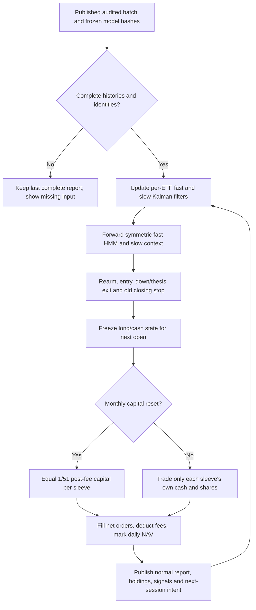

# BroadTrend — Full-Pool ETF Trend, version 1

Status: operator-authorized **monitoring**, registered 2026-10-29. No capital
allocation or broker authority was added. The canonical strategy key is
`broadtrend_full_pool_v1`. It uses a dedicated application calculation adapter
with scheduler `monthly_capital_daily_signals`; the existing execution capability
gate deliberately rejects this scheduler for funded trading.

[Research report, full mathematics and all 51 ETF charts](../research/broadtrend-fr25-20261029-v1/index.html)
· [Normal app strategy report](http://127.0.0.1:8000/api/v1/strategies/broadtrend_full_pool_v1/report)
· [70/30 comparison](broadtrend-fr25-comparison-2026-10-29.md).

Serving status: **monitoring active; report published**. The normal application
calculation completed on 2026-10-29 at 07:51 UTC and its served report was verified
at 12:27 UTC. Membership generation 6 includes all 51 ETF states, simulated
holdings, daily NAV, next-session intents, benchmarks and the decision flow.
The report ends on 2026-10-27: USO lacks the expected October 28 observation,
so the catalog correctly retains **Catching up**. Publication is complete;
data freshness remains one session behind. The unchanged resource gate passed
in the normal refresh. SOTA and funded allocation revision 7 remain unchanged.
See the [publication verification receipt](../research/broadtrend-fr25-20261029-v1/monitoring-verification.json).

## Immutable identity and inputs

- Model pack: `src/systematic_trading/research/broadtrend_models_v1.json`, version
  `broadtrend-models-1.0.0`, SHA-256
  `40cb164b06d0052ab7f7641d6446d0ee9f93c810ae8204d05f3b6114e74a994e`.
- The pack stores all 51 ETF identities, history origins, fast/slow filter fits,
  symmetric fast HMM, volatility scale, policy and thesis-exit thresholds. It
  also records the hash of the selected-model synthesis and original training
  batch `5688bb093a7481231f05b8ba4d84e3e26e016231ffeb42576b4e7aca12cf99bd`.
- Every model is fitted through 2022-12-30. This is the selected B policy,
  `symmetric-trend-sleeve-v1`, exactly matching `entry-value/hmm` and
  `stop-review/baseline`. It is not the trained reviewer or online Bayesian policy.
- Monitoring reads the latest published audited continuous history, verifies
  manifest and file hashes and identities, and explicitly uses adjusted OHLC
  with audited raw volume. Volume is descriptive only. No provider archive or
  online price is a calculation input. Original per-ETF history origins remain
  fixed because changing the filter initialization would change the algorithm.
- Require the complete supported trading calendar from each origin. Historical
  exchange closures are explicit exceptions; observations are never filled.
  End the whole portfolio at the last common complete session and disclose
  newer individual histories. Failures preserve the previous atomic publication.
- Updated adjusted histories may revise historical signals. Each report therefore
  pins its own publication and model hashes. Auditing does not establish
  historical dissemination or point-in-time universe membership.

## Trading and portfolio contract

At every completed close, each ETF updates two causal local-linear Kalman filters
of log adjusted price. The fast normalized slope enters a symmetric three-state
HMM. Slow-filter probabilities provide context. Entry requires eligible positive
fast slope and up-state probability, a flat actual account, and a rearmed entry
state. The desired target changes to cash on fast down, selected thesis failure,
or a held close below the previously established protection boundary. The
boundary can tighten but cannot loosen. Execute the prior decision at the next
session open; the old position bears the overnight gap.

All 51 virtual accounts run continuously from the 2022-12-30 close, regardless
of whether their state is long or cash. The funded portfolio retains the tested
2024-01-31 close anchor and first fill on 2024-02-01. This historical start is a
comparison convention inherited from the ranking study, not a needed feature
warmup of the full-pool strategy. There is no retrospective deposit/reset when
monitoring is enabled. Prospective observations start 2026-10-30.

At each month-end close, freeze equal sleeve capital for execution next open.
Each ETF receives 1/51 of post-fee NAV. An active sleeve holds shares; an inactive
sleeve holds cash. Between monthly resets, an ETF buy spends only its own cash,
and its sale returns cash only to that sleeve. Other positions keep their shares.
No top-N ranking, positive-return filter, daily cash redistribution, leverage,
automatic refitting or terminal liquidation is present.

Let \(a_i\in\{0,1\}\) be the delayed active state, \(O_i,C_i\) adjusted open/close,
\(q_i,c_i\) units/cash and \(f\) the per-side proportional fee. At a monthly open:

\[
V^+=V^- - f\sum_i |a_iV^+/51-q_i^-O_i|,
\quad q_i^+=a_iV^+/(51O_i),\quad c_i^+=(1-a_i)V^+/51.
\]

Between resets, buys use \(q_i^+=q_i^-+c_i^-/[O_i(1+f)]\), \(c_i^+=0\).
Sales use \(c_i^+=c_i^-+q_i^-O_i(1-f)\), \(q_i^+=0\). Daily value is
\(V_t=\sum_i(c_{i,t}+q_{i,t}C_{i,t})\). Fees default to 5 bp per side, with
zero cash interest, fractional adjusted USD units and no FX conversion. Money
fields named `*_cnh` in the shared report schema contain USD only when explicitly
labelled `accountingCurrency=USD`; there is no synthetic FX series.

## Monitoring, verification and recovery

The app owns replay and future updates through `broadtrend.py`,
`broadtrend_monitoring.py` and the existing atomic tracked runtime. The model
JSON participates in the calculation revision. There is no dependency on an
agent schedule or finite exported decision table. Membership is a durable
transactional event, `broadtrend-monitor-20261029-v1`, revision/generation 6;
the seed config is not membership authority. SOTA/allocation revision 7 was
preserved at registration.

The report publishes daily NAV, fills, held units/weights, sleeve capital,
current HMM scores, close-tested protection levels, next-session exposure
intents and monthly schedule. Intent weights use known close prices; actual
orders retain unchanged quantities and size new purchases from sleeve cash at
the execution open. They are not instructions to rebalance unchanged positions
daily. The normal report freshness status can remain “Catching up” if one
constituent lacks the expected session. Initial validation ended 2026-10-27 due
to USO; this is disclosed rather than filled with another source.

Exact replay reproduces all 51 historical signal/NAV paths and the earlier
full-pool result. Independent global cash/share reconstruction reconciles each
daily NAV. Prefix tests establish that changing/truncating future data does not
alter earlier states or fills. Separate tests cover model tampering, month-end
current intents, retained sleeve cash, internal fee netting and the closed broker
execution gate. Native Windows LEAN agrees with the app reference on accounting
fixtures; those fixtures reconstruct execution-open targets and use whole shares
and cent prices. They do **not** independently validate HMM inference or the
fractional strategy's production execution. This remains a monitoring contract.

Archive through the normal lifecycle service to stop tracking. Retain the latest
published report, versioned model pack, compact findings and recipes. Rollback
of code must use a coherent prior version and normal refresh; never edit a
published calculation or manually patch current target weights. No pending or
funded strategy is to be retired by this research work.

## Limitations and next evidence

This strategy is a selected development recipe, not an established alpha model.
The earlier separately fitted full pool lost 1.13% in 2021–2022. Later strength
may reflect market beta, asset trends and cash. Its 51 ETFs overlap; the number
of names is not the number of independent risks. Full-pool superiority is
specific to tested rank selectors and primary metrics.

Two parallel Kalman filters plus one HMM do not establish a learned multi-year
economic regime. Slope observations are serially correlated and HMM scores are
not calibrated profitability probabilities. Frozen scale and persistence can
react too slowly to new markets. Inherited policy/thesis thresholds were not
jointly reoptimized under the final symmetric HMM. Larger-loss/reset/reviewer
branches are explicitly absent. Daily states evolve, parameters do not.

Closing stops are not hard loss limits. Intraday selloffs, opening gaps, false
breakouts, delayed rearming and missed rebounds remain. Adjusted fractional
units do not implement actual corporate-action share accounting, broker lot
constraints, spread/impact, borrow, tax or FX. Cash has zero modeled interest.
Repeated inspection, retrospective cohort construction and revised histories
make historical confidence intervals descriptive.

The next useful evidence is prospective monitored performance, retained-cash
and equal-volatility controls, broader chronological validation of FR25/BroadTrend
and eventual independent implementation of the daily sleeve execution contract.
Do not retune the 70/30 weight after seeing this result and call it confirmation.

## Full ETF model mathematics

The equations below are the selected algorithm's frozen synthesis. The inherited
`family` label records original threshold selection; every current fast-state
classifier uses the symmetric HMM. Per-ETF numerical values live in the pinned
model pack and the report's ETF inspector.

### 1. Price and training scale

$$
y_t=\log C_t,\qquad \sigma=\operatorname{sd}_{\mathrm{train},ddof=0}(y_t-y_{t-1})
$$

C is the published dividend/split-adjusted close. The chosen final market fit uses population standard deviation (ddof=0), frozen at the training cutoff. Raw volume is displayed for inspection but does not enter this chosen algorithm.

### 2. Two parallel local-linear filters

$$
z_{j,t}=Fz_{j,t-1}+\eta_{j,t},\quad y_t=Hz_{j,t}+\epsilon_{j,t},\quad z=(\ell,b)^T,\quad Q_j=\mathrm{diag}(0,\lambda_jR_j)
$$

j is fast or slow. F=[[1,1],[0,1]], H=[1,0], observation noise variance R, independent Gaussian slope innovation variance λR. Initial mean (log C₀,0), covariance R I. These are two estimates of the same price, not additive factors and not two interacting HMMs.

### 3. Causal Kalman recursion

$$
m_t^-=Fm_{t-1},\ P_t^-=FP_{t-1}F^T+Q,\ e_t=y_t-Hm_t^-,\ S_t=HP_t^-H^T+R
$$

Only prices available through the current completed close enter the update. The first 252 observations initialize filtering before the HMM observations and likelihood scores begin.

### 4. Updated level and slope

$$
K_t=P_t^-H^T/S_t,\qquad m_t=m_t^-+K_te_t,\qquad P_t=(I-K_tH)P_t^-
$$

Fast and slow filters each have their own fitted R and λ. State estimates keep changing every day; their noise parameters remain fixed in the historical evaluation.

### 5. Fit filter smoothness separately for each ETF

$$
\widehat R(\lambda)=\max(10^{-12},\operatorname{mean}_{t\geq252}(e_t^2/S_t^{(R=1)})),\quad \widehat\lambda=\arg\min_\lambda\frac{1}{2}\sum_{t\geq252}\left[\log(2\pi\widehat R S_t^{(R=1)})+\frac{e_t^2}{\widehat R S_t^{(R=1)}}\right]
$$

Slow λ∈[10⁻¹⁰,10⁻⁶]; fast λ∈[10⁻⁵,10⁻²]. Search log λ with bounded scalar minimization (tolerance .15, max 18 iterations), compare both endpoints. This fits price likelihood, not trading profit, and the allowed smoothness ranges are imposed.

### 6. Slow context

$$
p^s_D=\Phi\left(\frac{-0.02\sigma-\widehat b_s}{\sqrt{P_{s,bb}}}\right),\quad p^s_U=1-\Phi\left(\frac{0.02\sigma-\widehat b_s}{\sqrt{P_{s,bb}}}\right),\quad A_t=\mathbf{1}(p^s_U\geq0.70)
$$

pˢ_R=1−pˢ_D−pˢ_U; slow down means pˢ_D≥.70, otherwise context can be uncertain. Numerical slope variance is floored at 10⁻²⁰. Slow down does not veto buying a short rebound.

### 7. Symmetric fast-state observation model

$$
x_t=\widehat b_{f,t}/\sigma,\quad f_D(x)=\mathcal{N}(x;-a,v),\quad f_R(x)=\mathcal{N}(x;0,v_R),\quad f_U(x)=\mathcal{N}(x;a,v)
$$

a∈[.2,2], v∈[.01,4], vR∈[.000025,.01]. D/R/U mean negative slope, near-zero slope and positive slope under this statistical model; R does not establish a geometric horizontal trading box.

### 8. Forward HMM inference

$$
p_t(k)=\frac{f_k(x_t)\sum_j p_{t-1}(j)T_{jk}}{\sum_h f_h(x_t)\sum_jp_{t-1}(j)T_{jh}},\qquad \log\frac{f_U(x)}{f_D(x)}=\frac{2ax}{v}
$$

At the first HMM observation (index 252), use the fitted initial distribution directly before normalization. Training may use backward probabilities; trading never does. Shared directional variance gives monotone up/down emission odds, but persistent transition priors can still dominate small new slopes.

### 9. Fit symmetric emissions

$$
a\leftarrow\operatorname{clip}\left(\frac{\sum_t x_t(\gamma_{tU}-\gamma_{tD})}{\sum_t(\gamma_{tU}+\gamma_{tD})},.2,2\right),\quad v\leftarrow\operatorname{clip}\left(\frac{\sum_t[\gamma_{tD}(x_t+a)^2+\gamma_{tU}(x_t-a)^2]}{\sum_t(\gamma_{tD}+\gamma_{tU})},.01,4\right)
$$

γ and ξ are standard forward/backward training state/transition expectations. vR is the γR-weighted x² mean, clipped to [.000025,.01]. Denominators use a 10⁻¹² numerical floor. Two starts a=.2/.4, 25 iterations; retain the highest penalized training likelihood across starts and iterations.

### 10. Fit transition persistence

$$
\widetilde T_{jk}=\frac{\sum_t\xi_t(j,k)+0.1+3\mathbf{1}(j=k)}{\sum_h[\sum_t\xi_t(j,h)+0.1+3\mathbf{1}(j=h)]},\quad J=\log L+3\sum_j\log T_{jj}+0.1\sum_{jk}\log T_{jk}
$$

Clamp each diagonal to [.65,.98] and rescale off-diagonals proportionally to keep each row summing to one. Update initial π=(γ₀+.1)/1.3. Initial T has diagonal .94/off-diagonal .03 and uniform π; directional variance starts as clip(sample population variance,.01,4), neutral variance .01.

### 11. Entry, context and ordinary exit

$$
E_t=\mathbf{1}(p_{tU}\geq e)\mathbf{1}(\widehat b_{f,t}>0),\quad h_t=d+(.85-d)cA_t,\quad D_t=\mathbf{1}(p_{tD}\geq h_t)
$$

Per-ETF e,d∈{.60,.75}; c is the inherited context flag. Protection multiple is kₜ=2k₀ if cAₜ=1, otherwise k₀, with k₀∈{3,5}. Every selected ETF now uses the symmetric fast HMM even if its inherited metadata says family=slope.

### 12. Optional persistent thesis failure

$$
q_t=q(1-A_t/2),\quad k_t^{\mathrm{fail}}=k+2A_t,\quad n_t=\mathbf{1}(p_{tU}<q_t)(n_{t-1}+1),\quad F_t=\mathbf{1}(n_t\geq k_t^{\mathrm{fail}})\mathbf{1}(\widehat b_{f,t}\leq0)
$$

Use only when the inherited per-ETF training-selected thesis rule is enabled; otherwise F=0. Candidate q∈{.1,.2,.3}, k∈{2,3}. The stronger slow-up tolerance applies to this thesis rule even if c=0. The run counts all observed closes, not just held sessions.

### 13. Initial and ratcheting closing protection

$$
B_e=O_e(1-k_{\mathrm{signal}}\sigma),\quad M_t=\max(O_e,C_e,\ldots,C_t),\quad B_{t+1}=\max(B_t,M_t-k_t\sigma O_e)
$$

Oe is the actual entry fill. Risk uses frozen training σ times entry price, not current ATR. While held, first test today's close against the previously adopted B; only then raise tomorrow's boundary. Existing boundaries never widen. B is a close-trigger boundary, not a resting intraday order or guaranteed loss cap.

### 14. Position decisions and rearming

$$
X_t=D_t\vee F_t\vee(\mathrm{held}_t\wedge C_t<B_t),\quad \mathrm{held}_t=d_{t-1-\Delta},\quad \mathrm{rearm}_t=\mathbf{1}(p_{tU}<.50)
$$

d is the desired binary position, initially zero. First set armed=true on rearm. If d=1 and X=1, set d=0 and armed=false. Else if d=0, actually flat, armed and E=1, set d=1 and armed=false. Otherwise retain d. Next-open lag is 1+Δ; Δ=0 primary, 1 stress. Pending target snapshots execute at their scheduled opens; a reversal can be scheduled before an earlier target fills. A range state alone is not an exit.

### 15. Self-financing account

$$
Q_e=\frac{K_{e^-}}{O_e(1+f)},\quad K_x=Q_{x^-}O_x(1-f),\quad V_t=K_t+Q_tC_t,\quad r_t=V_t/V_{t-1}-1
$$

Buy with all available sleeve cash; sell all shares; f=5/10/20 bp per side. No leverage, cash interest zero, fractional adjusted units. Trading signals and close boundaries fill at later opens. First evaluation account starts flat/funded; filter history is carried. Terminal holdings are marked, not forcibly liquidated. No fixed TP, recovery override, Bayesian policy learner or learned return gate is active.

### 16. Inherited policy fitting objective

$$
U=.45\operatorname{clip}((g-g_{BH})/.10,\pm3)+.40\operatorname{clip}(S-S_{BH},\pm3)+.15\operatorname{clip}(K-K_{BH},\pm3)
$$

g=CAGR, S=annualized daily Sharpe, K=CAGR/max(.03, drawdown magnitude) for the historical optimization only. Reported Calmar instead uses actual drawdown. The utility compares the training strategy with its ETF buy-and-hold under the original protocol.

### 17. Stability and evidence penalties

$$
J_p=.5U_{\mathrm{full}}+.5\operatorname{median}(U_1,U_2,U_3)-.25\operatorname{sd}(U_1,U_2,U_3)-.1\frac{(10-n)_+}{10}-.3\frac{(.2-e_x)_+}{.2}
$$

Three equal chronological training blocks; n completed trades and eₓ exposure. Original 24 policies cover slope/HMM/context families × entry .6/.75 × exit .6/.75 × distance 3/5. Keep top two per family, then rescore six fee/delay settings; prefer candidates with ≥5 closed trades and ≥5% exposure in every setting, then highest worst-setting J. Exact selected parameter snapshots are retained; the symmetric HMM replaces the detector afterward without jointly retuning these thresholds.

### 18. Portfolio ranking inputs — proposed next experiment

$$
R_{i,L,t}=\prod_{s=t-L+1}^{t}(1+r_{i,s})-1,\quad S_{i,L,t}=\sqrt{252}\frac{\overline{r}_{i,L,t}}{s(r_{i,L,t})},\quad L_s=63,\ L_l=252
$$

rᵢ is the net return of ETF i's continuously simulated chosen strategy, including cash days. Primary short/long horizons are 63/252 sessions; 21/126 is a declared sensitivity. At least Llong+1 causally generated NAV observations, two nonzero-return days, finite positive short and long SD; otherwise ranking unavailable. Flat zero-variance sleeves are not assigned infinite Sharpe. Cash rate remains zero for matched research.

### 19. One combined rank table

$$
\mathrm{score}_{i,t}=\frac{1}{4}[\mathrm{pct}(R_{i,63,t})+\mathrm{pct}(S_{i,63,t})+\mathrm{pct}(R_{i,252,t})+\mathrm{pct}(S_{i,252,t})],\quad \mathrm{pct}(x)=\frac{\mathrm{averageRank}(x)-1}{M-1}
$$

Higher is better; average ranks handle ties, ticker breaks equal combined scores. M is the eligible risky pool size; BIL is a cash reference, not a ranked candidate. Monthly close selects top N without a positive-return gate; even the best ranks can be losing. N∈{6,10,15,20,30}, with 15 only an illustrative preview, not a chosen optimum.

### 20. Equal capital and covariance of strategy risk

$$
w_i^{EW}=1/M_N,\quad \widehat\Sigma=252\operatorname{Cov}_{252}(r),\quad \widetilde\Sigma=.5\widehat\Sigma+.5\mathrm{diag}(\widehat\Sigma)+\mathrm{diag}[(.05^2-\mathrm{diag}(\widehat\Sigma))_+]
$$

M_N=min(N,eligible count). Equal-weight and risk-weight budgets sum to one across selected strategy sleeves. Covariance includes cash observations and simultaneous losses. A 50% diagonal shrinkage and 5% annualized volatility floor prevent a nearly inactive sleeve receiving unbounded weight. These are declared engineering choices, not tuned portfolio results.

### 21. Equal risk contribution, not inverse variance

$$
x^*=\arg\min_{x_i>0}\left[\frac{1}{2}x^T\widetilde\Sigma x-\frac{1}{M_N}\sum_i\log x_i\right],\quad w_i=\frac{x_i^*}{\sum_jx_j^*},\quad \frac{w_i(\widetilde\Sigma w)_i}{w^T\widetilde\Sigma w}=\frac{1}{M_N}
$$

This defines covariance-aware equal risk contribution. With diagonal covariance it reduces to inverse volatility, 1/√variance, not 1/variance. No leverage. Large N does not guarantee independent exposures; inspect effective number 1/Σw², correlations and sector/asset concentration.

### 22. Membership, capital and actual exposure differ

$$
W_{i,t}=\frac{V^{\mathrm{sleeve}}_{i,t}}{V_t^{\mathrm{portfolio}}}\,h_{i,t},\quad W_{cash,t}=1-\sum_iW_{i,t},\quad N_{eff}=1/\sum_iw_i^2
$$

Monthly allocation sets initial sleeve budgets. They then drift with each sleeve's returns; h is its actual binary invested state. A strategy sell moves that sleeve to cash. Do not renormalize other ETFs daily or replace a flat member before the next pool selection. Portfolio accounting must use actual fills, not both net sleeve returns and duplicate underlying trade fees.

### 23. Timing sensitivity and broad-N preference

$$
D_t=\sum_{i\in\{ETFs,cash\}}|w^{\mathrm{theory}}_{i,t}-w^{\mathrm{last\ adopted}}_{i,t}|,\quad N^*=\max\{N:S_N\geq S_{best}-.05,\ g_N\geq g_{best}-.01,\ DD_N\leq DD_{best}+.02\}
$$

Monthly membership is primary. A separate dynamic control adopts targets on monthly dates or cash-inclusive L1≥.10; it does not replace the monthly design. Daily signal exits always execute in both. Select N only inside chronological training/validation, preferring the largest acceptable performance plateau; report the full N curve and untouched subsequent results. If no robust plateau transfers, retain no performance claim.
