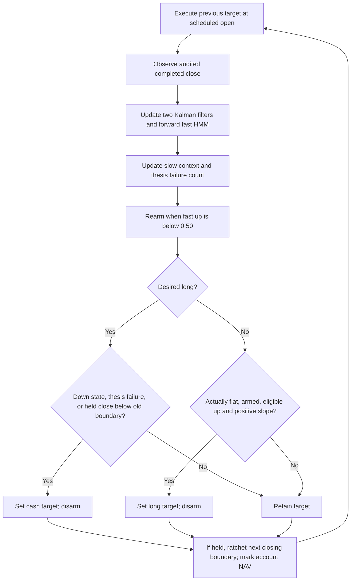
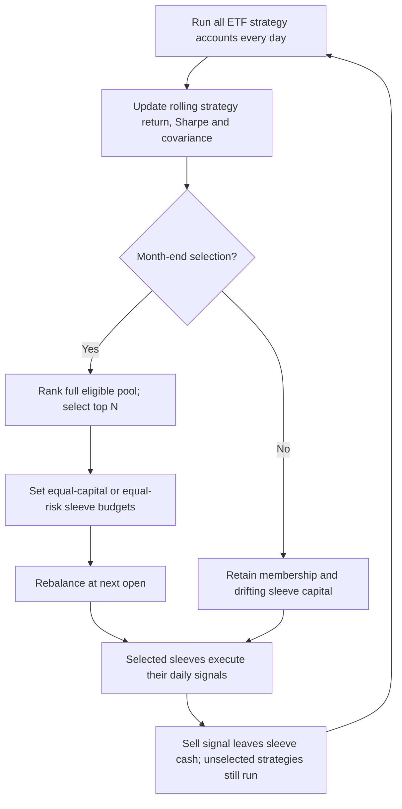

# Single-ETF synthesis and monthly strategy ranking

The operator closes the single-ETF improvement branch for now and moves toward
an ETF portfolio chosen from continuously maintained strategy histories.
[Full report: mathematics, flowcharts, rank preview and every ETF chart](../research/trend-sleeve-synthesis-20261029-v1/index.html).

## Selected research building block

Choose **symmetric-trend-sleeve-v1**, an exact descriptive alias of
`entry-value-20261027-v1 / hmm` (former B), also reproduced as
`stop-review-20261027-v1 / baseline`. This retains the operator's earlier B
preference and transparent symmetric directional emissions. It is a working
research choice, not the highest result in every metric or a promoted strategy.
The older fixed detector is stronger in later-period pool medians; both remain
visible. Do not describe a statistically established universal winner.

The algorithm has two forward local-linear price filters, one symmetric
three-state fast-slope HMM, frozen per-ETF trading thresholds, slow-context exit
tolerance, a training-selected simple thesis-failure exit, and a ratcheting
closing protection boundary. New evidence updates filtered states daily; model
parameters do not refit. There is no online return gate, learned reviewer,
Bayesian policy switch/reset, recovery override or standing intraday stop.
Volume is inspection context, not a signal in this selected version.

The report supplies 23 equations, exact 102 ETF/era snapshots, fitting lineage,
execution priority, fees and timing. Inherited `family=slope` metadata refers
to original policy selection; every ETF now uses the symmetric fast HMM.
Original threshold/thesis fitting was not jointly repeated under this final HMM.

## Evidence retained

Medians across risky ETFs, excluding BIL; 5 bp each side / next open. Later
2023-01-03..2026-10-16, earlier 2020-01-02..2022-12-30. These are single-ETF
medians, not portfolio outcomes.

| Period | Algorithm | Net cumulative return | CAGR | Sharpe | Calmar |
|---|---|---:|---:|---:|---:|
|Later|Original fixed detector|16.72%|4.18%|0.419|0.252|
|Later|Selected symmetric HMM|12.35%|3.13%|0.392|0.273|
|Later|Standing-stop comparator|11.39%|2.90%|0.402|0.260|
|Earlier|Original fixed detector|7.45%|2.43%|0.276|0.149|
|Earlier|Selected symmetric HMM|7.38%|2.40%|0.322|0.184|
|Earlier|Standing-stop comparator|6.33%|2.07%|0.312|0.173|

The chosen algorithm's weakest risky ETF by primary net cumulative return is
CORN later −23.25% (17 trades/five wins, drawdown 30.04%) and MCHI earlier
−34.29% (25 trades/seven wins, drawdown 50.41%). These are the chosen B results,
not the previous report's standing-protection/reviewer outcomes. Dedicated
[CORN](../research/trend-sleeve-synthesis-20261029-v1/CORN_late.png) and
[MCHI](../research/trend-sleeve-synthesis-20261029-v1/MCHI_early.png) charts
show price/volume, states, actual fills, closing boundaries and NAV.

The accumulated work found useful components and failure modes, not a general
single-ETF alpha. Tight exits can cut winners; more HMM structure did not prove
better economic detection; loss-feedback adaptation often failed good-asset
preservation; entry forecasts often became lagging means; independent buy/hold
reviewers contradicted each other; coherent abstention prevented harm without
establishing active value. Standing protection helped CPER but remains a separate
daily-OHLC execution assumption, with mixed broad outcomes.

Important remaining limitations: repeated inspection, full-training fitted
calibration, inherited thresholds, fixed noise/volatility and transition
parameters, serial dependence of HMM observations, market exposure, shallow
declines mistaken for range states, delayed rearming, unbounded gap losses,
data-vintage/survivorship issues, and approximate research execution. These are
discussed at length in the report. Native parity validates accounting, not alpha.

## Next portfolio specification

The operator clarifies that this is a rolling rank-table selector: all ETF
strategies run continuously, only top N are selected into the portfolio say
monthly, and selected ETFs keep trading their daily signals. Larger N is
preferred if diversification helps. This supersedes the earlier deferral of
portfolio research; it does not authorize changing execution or live policy.

- Rank **strategy-account returns**, including cash days, rather than raw ETF
  performance or only winning/closed trades. Continue virtual histories while
  unselected. Do not reset the algorithm on entering/leaving the pool.
- Primary score: average of cross-sectional percentile ranks of 63d return,
  63d Sharpe, 252d return and 252d Sharpe. Equal weights; 21/126 is a separate
  window sensitivity. BIL remains a cash reference, not a risky candidate.
  Require complete aligned history and defined short/long volatility; do not
  turn zero volatility into infinite Sharpe. No positive-score gate in the
  initial design; top ranks can still have negative returns.
- Test N=6/10/15/20/30, show the whole curve, and select N only within prior
  chronological validation. Prefer the largest near-best plateau: Sharpe within
  .05, CAGR within 1pp and drawdown within 2pp of the best training choice.
  N=15 in the preview is illustrative, not an optimum or adopted target.
- Main allocation choices: equal sleeve capital and covariance-aware equal risk
  contribution. Risk is computed from strategy returns, with 252-session sample
  covariance, 50% diagonal shrinkage and a 5% annualized volatility floor.
  Diagonal-covariance risk parity is inverse volatility, not inverse variance.
- Monthly-close membership/capital decisions execute next open. Daily strategy
  buys/sells remain active between those dates. Selling leaves cash in the same
  sleeve; no automatic refill or daily renormalization of other ETF exposures.
  Sleeve budgets drift with their own performance until the next rebalance.
- A newly selected already-long virtual sleeve is entered at the allocation
  open using existing signal/protection state. Its real cost basis can differ
  from the virtual entry. An exit due at that open takes priority. Departing
  members are liquidated; virtual accounts continue for ranking. Attribute
  membership trades separately from strategy-signal trades.
- Monthly is primary. Retain a separate monthly-or-cash-inclusive-L1≥10%
  dynamic target-change control. Compare latest theoretical with last adopted
  targets; actual-held housekeeping remains separate. Do not confuse daily
  strategy trading with daily membership rotation.
- Compute portfolio P&L from actual netted fills, fees and cash. Shadow net
  returns drive ranks, not an extra layer of actual portfolio fees. Avoid
  charging signal trading costs twice. Compare full-pool unranked sleeves,
  matched raw-ETF momentum, buy/hold/cash and FR25 on compatible data/dates.
- Use only causal strategy histories for ranking/risk. The frozen 2019/2022
  fits cannot create out-of-sample pre-cutoff ranking records. First development
  replay needs 252 post-fit return sessions before common portfolio evaluation
  (approximately 2021/2024 starts, exact dates to be pinned). Stronger future
  validation needs rolling/cross-fitted records and inner N selection. Reused
  historical eras are not fresh holdouts.

The historical rank preview is as of 2026-10-16, not today's signal. It exposes
capital weights and current invested weights separately. Risk floors do not
guarantee diversification: report effective N, maximum sleeve size, actual
invested breadth and asset/sector correlations. No portfolio backtest or return
claim is part of this synthesis. No application monitoring, promotion, paper
allocation, broker or live state changed.

## Reproduction and evidence

Builder: `scripts/build_trend_sleeve_synthesis.py`; it verifies parent fits and
input hashes, confirms all 612 fee/delay baseline return matches, extracts the
102 exact parameter sets, and recomputes the historical rank/allocation preview.
Report assets and equations are under `scripts/assets/trend-sleeve-*`.
Artifact tests cover cutoff causality, unavailable constant series, covariance
risk budgeting, cash conservation, calendar alignment and saved model identity.
Offline controls cover every ETF/era chart and N/weighting preview. Figures and
equations are inspected separately; browser layout is not certified.
