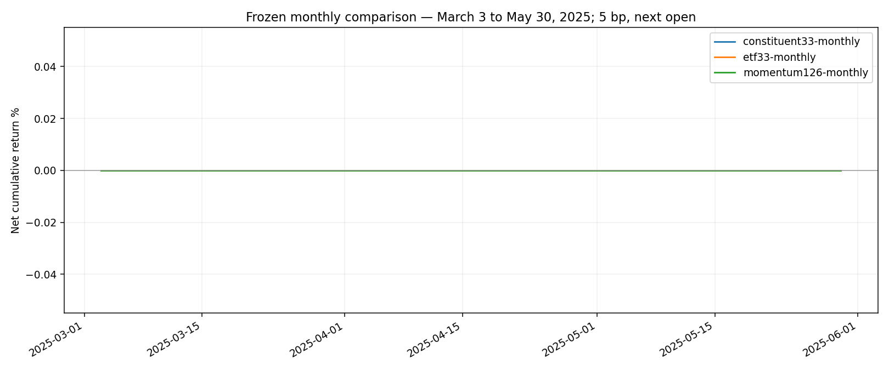

# P4.21 — constituent Alpha33 feasibility pilot

Completed 108 new net backtests plus one frozen-weight winner-dependence replay. March 3–May 30, 2025; no parameter selection, training fit or claimed pristine OOS result. The monthly case remains the primary test regardless of sensitivity results. No strategy was promoted or given execution authority.

## Main comparison

| Model / control | Net return | Annualized Sharpe | Max drawdown | Fees USD | Mean invested |
| --- | ---: | ---: | ---: | ---: | ---: |
| constituent33-monthly | 0.00% | 0.000 | -0.00% | 0.00 | 0.00% |
| etf33-monthly | 0.00% | 0.000 | -0.00% | 0.00 | 0.00% |
| momentum126-monthly | 0.00% | 0.000 | -0.00% | 0.00 | 0.00% |
| unranked-monthly | 0.00% | 0.000 | -0.00% | 0.00 | 0.00% |
| covered-buyhold | -2.74% | -0.345 | 11.99% | 490.28 | 98.02% |
| full-pool-buyhold | 1.50% | 0.402 | 10.42% | 491.90 | 98.40% |
| FR25-reference | -0.50% | -0.078 | 8.31% | 1,248.77 | 98.21% |
| URTH | 1.17% | 0.301 | 15.37% | 493.99 | 98.80% |
| BIL | 0.94% | 15.033 | 0.05% | 490.11 | 98.08% |
| cash | 0.00% | 0.000 | -0.00% | 0.00 | 0.00% |

The same daily coverage and liquidity mask governs the three models and unranked control. Holdings coverage can change by day; see [every eligibility change](coverage.json). All controls use the same audited ETF quotes and accounting, except FR25's frozen signal generation comes from its original published inputs. FR25 is an empirical reference, not a matched constituent-alpha ablation. Cash earns zero; BIL/URTH controls have a 98% initial allocation. Buy-and-hold controls enter once and drift, with no terminal liquidation.

## What was tested

Public December 31, 2024 SEC holdings, filed before the first signal → dated permanent security identity → separately audited stock open/close → rank(open/close − 1) across unique observed constituents → filed-value weighted ETF score, only with at least 95% equity value and 70% position coverage → same eligible ETF pool → top six and 63-return inverse volatility → 98% budget, 45% cap → frozen rebalance policy → next-open whole adjusted-unit fills and fees.

Higher Alpha33 selects stocks whose open was high relative to the close, an intraday reversal hypothesis. ETF33 applies the same formula directly to each ETF. Momentum uses 126-session return; unranked removes the score ranking. Missing positions stay in the coverage denominator. Fewer than six eligible names or all equal ranked scores produces cash. No stops, protective exits, leverage, fitting or rule changes follow from these results. Full decision and source rules: [frozen protocol](protocol.json).

## Chronology and timing

| Month | Constituent33 return / Sharpe | ETF33 return / Sharpe | Momentum return / Sharpe |
| --- | ---: | ---: | ---: |
| march | 0.00% / 0.000 | 0.00% / 0.000 | 0.00% / 0.000 |
| april | 0.00% / 0.000 | 0.00% / 0.000 | 0.00% / 0.000 |
| may | 0.00% / 0.000 | 0.00% / 0.000 | 0.00% / 0.000 |

| Timing (fixed before results) | Constituent33 return / Sharpe / turnover | ETF33 return / Sharpe / turnover | Momentum return / Sharpe / turnover |
| --- | ---: | ---: | ---: |
| monthly | 0.00% / 0.000 / 0.0x | 0.00% / 0.000 / 0.0x | 0.00% / 0.000 / 0.0x |
| daily | 0.00% / 0.000 / 0.0x | 0.00% / 0.000 / 0.0x | 0.00% / 0.000 / 0.0x |
| 0.40 | 0.00% / 0.000 / 0.0x | 0.00% / 0.000 / 0.0x | 0.00% / 0.000 / 0.0x |

Turnover is annualized gross traded notional / opening NAV. Annualized Sharpe and turnover over this short window are descriptive, not forecasts. Target-change threshold is strict L1 >0.40 including cash versus the last adopted target, plus monthly reset; actual holdings drift is not a trigger. Daily is a fixed-interval sensitivity, not a post-result recommendation.

| Cost bp | Extra session | Primary return | Sharpe | Drawdown |
| ---: | ---: | ---: | ---: | ---: |
| 5 | 0 | 0.00% | 0.000 | -0.00% |
| 5 | 1 | 0.00% | 0.000 | -0.00% |
| 10 | 0 | 0.00% | 0.000 | -0.00% |
| 10 | 1 | 0.00% | 0.000 | -0.00% |
| 20 | 0 | 0.00% | 0.000 | -0.00% |
| 20 | 1 | 0.00% | 0.000 | -0.00% |

[Every cost, delay, control and monthly metric](results.json) includes actual fees, exposure, turnover, return and drawdown. No annual cost ceiling is imposed.

## Winner dependence

Largest primary contributor: AGG, 0.00 percentage points. Replacing only that asset's frozen weights with cash, without reranking or reallocating, gives 0.00% net return, Sharpe 0.000 and drawdown -0.00%. This is an ex-post sensitivity, not a new strategy or a causal claim about a market theme. [Full attribution](attribution.json), [winner diagnostic](winner-dependence.json) and [individual same-window buy-and-hold references](individual-buyhold.json) are retained.

## Coverage and evidence limits

Screened all 52 supported-pool candidates; 52 have qualified complete ETF prices. Only 16 had the selected public holdings quarter. Initial eligible allocation pool: XLE, XLK, XLP, XLU, XLV. Daily eligible counts range from 5 to 5. This cannot establish superiority over the full 52-candidate pool.

| Fund with public holdings | Eligible sessions (including final diagnostic close) | Initial equity-value coverage | Minimum coverage |
| --- | ---: | ---: | ---: |
| IAT | 0 | 94.48% | 94.48% |
| IBB | 0 | 82.01% | 81.93% |
| ITA | 0 | 62.65% | 62.65% |
| IWM | 0 | 84.25% | 84.17% |
| MDY | 0 | 90.99% | 90.99% |
| SOXX | 0 | 86.10% | 86.10% |
| SPY | 0 | 92.62% | 92.62% |
| XLB | 0 | 69.57% | 69.57% |
| XLC | 0 | 88.40% | 88.40% |
| XLE | 64 | 95.89% | 95.89% |
| XLI | 0 | 81.94% | 81.94% |
| XLK | 64 | 95.47% | 95.47% |
| XLP | 64 | 97.17% | 97.17% |
| XLU | 64 | 96.19% | 96.19% |
| XLV | 64 | 97.22% | 97.22% |
| XLY | 0 | 92.52% | 92.52% |

- Only one public holdings quarter; portfolios deliberately frozen, not contemporaneous actual holdings after December 2024.
- Full 52-candidate scope screened, but holdings-signal allocation only where public dated holdings and daily coverage qualify; not a full-pool superiority claim.
- Current-vintage revised prices and CRSP identities; original historical dissemination is unknown. Public SEC filing availability is evidenced separately. Reused history is not pristine out of sample.
- Three months cannot establish Sharpe stability or an investment edge. Annualized metrics are descriptive only; inspect monthly results and winner dependence.
- Synthetic whole adjusted units, zero cash interest, no taxes/spread/impact; stated per-notional costs and delay sensitivity only. No stops or protective exits.

WRDS extracts remain saved locally with exact SQL, parameters, types, timestamps and hashes. Backtesting reads a new immutable native publication after field/date qualification; it never reads provider archives as strategy inputs. Original volume/full-history audit verdicts were preserved. The projection supports open/close only and is research-only. Public filing dates are evidenced; price vintage dissemination remains unknown. [Publication receipt](publication.json).

## Weakest held risky ETF

Criterion fixed before results: lowest net contribution divided by opening portfolio NAV, excluding cash references and assets never held in the window. This contribution criterion includes allocation and costs; it is not the asset's standalone return. Every monthly window is shown. FIFO lots overlapping a window may span other months and therefore do not sum to that month's contribution.

## Validation

Independent native LEAN verified 3 cases: primary constituent, matched ETF control and dynamic stressed/delayed constituent. Maximum daily NAV difference was $0.00. The separate inspection book reconciled within $0.0000. Native replay validates orders, fills, cash and NAV from frozen targets, not the economic hypothesis. [Native validation](native-validation.json).
